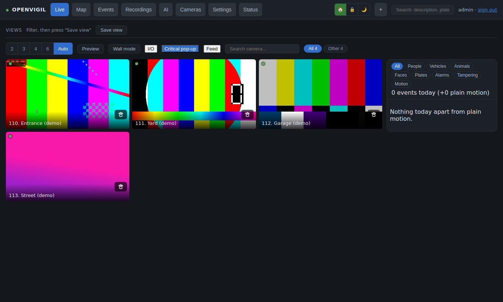
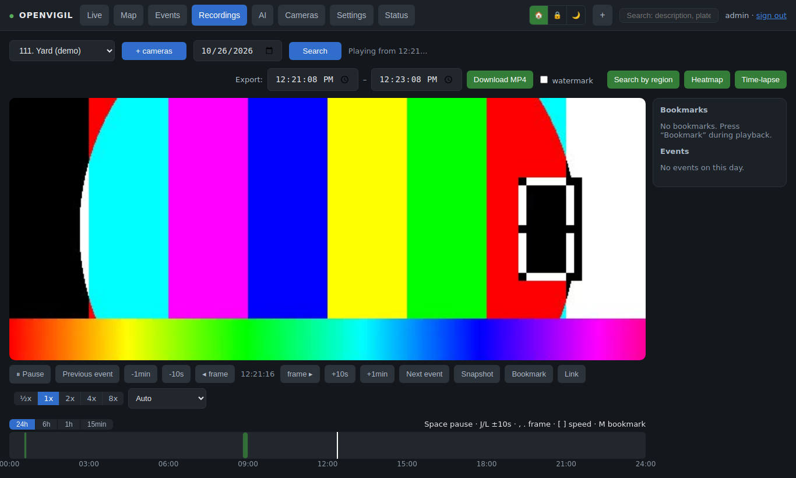
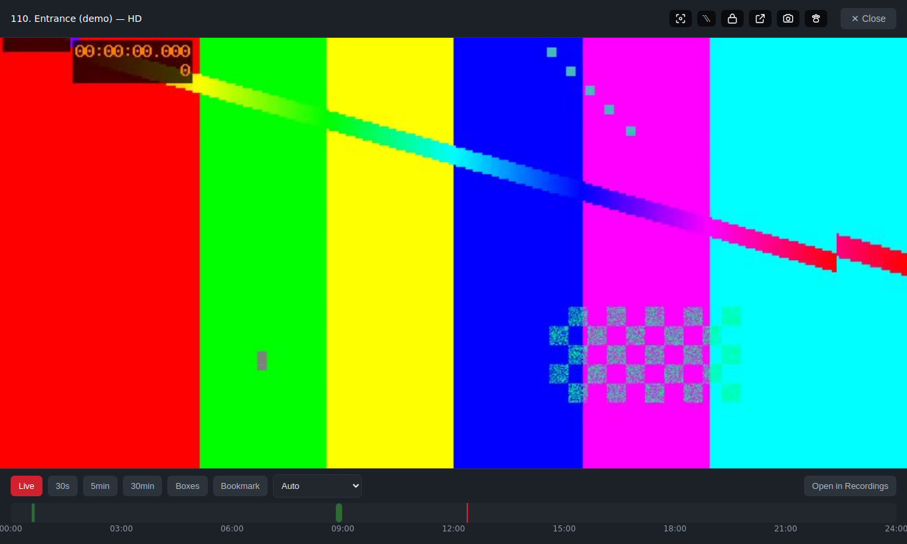
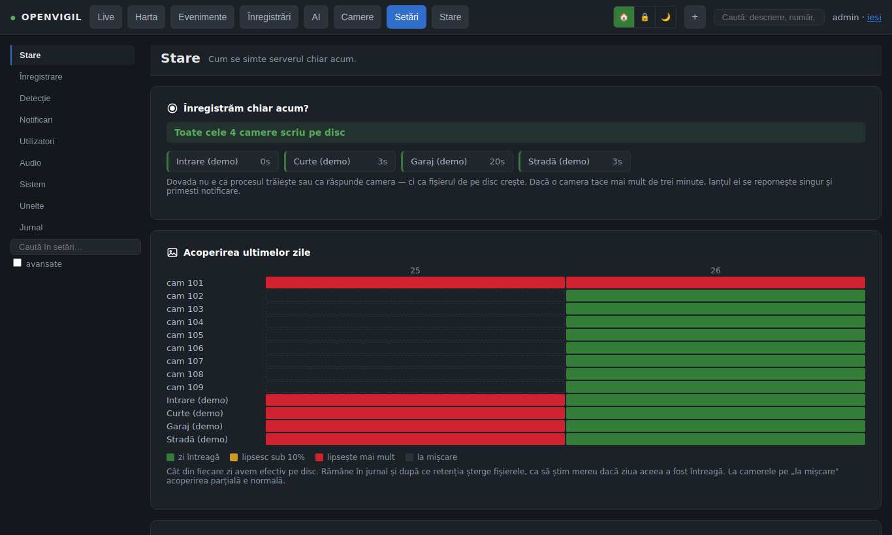
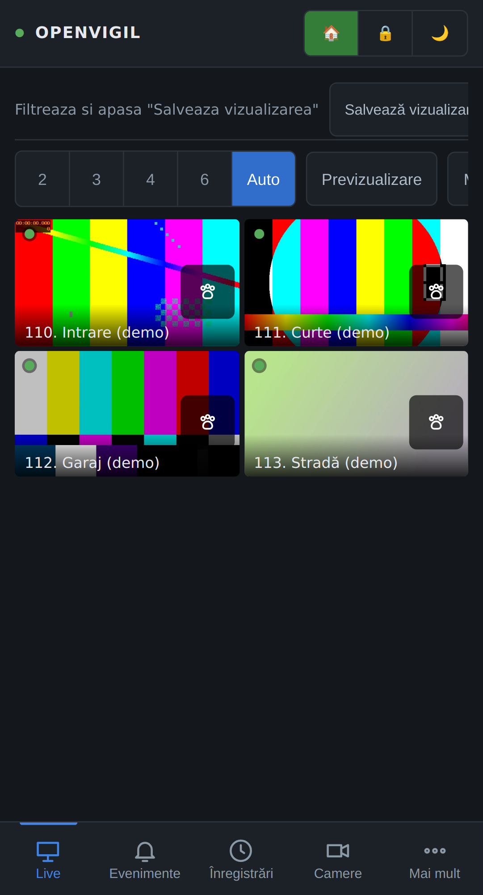
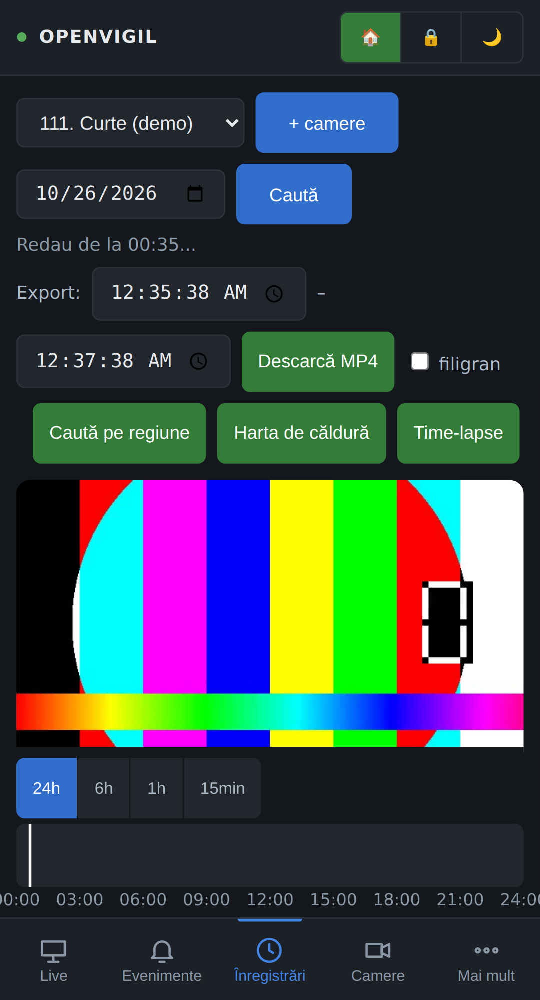
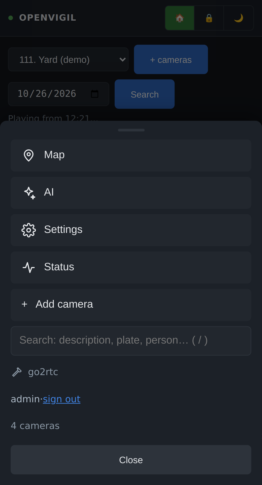

# OpenVigil

[](https://github.com/sm26449/openvigil/actions/workflows/ci.yml)
[](https://github.com/sm26449/openvigil/actions/workflows/imagine.yml)

NVR auto-găzduit pentru camere IP (Hikvision în primul rând, ONVIF în al doilea): înregistrează
totul local, rulează AI pe GPU-ul tău și nu vorbește cu niciun cloud. Un singur stack Docker,
o singură comandă de instalare.

**Site: [openvigil.dev](https://openvigil.dev)** · *English: [README.md](README.md) · manualul complet: [docs/ro/manual.md](docs/ro/manual.md)*

> **Stare.** Scris pentru o instalație reală (18 camere Hikvision, un RTX 2000 Ada, în
> funcțiune non-stop din 2026) și publicat așa cum e, sub AGPL-3.0. E un sistem care merge,
> nu un produs: pe alt hardware pot apărea colțuri netăiate. Licențele modelelor descărcate
> sunt în [NOTICE.md](NOTICE.md).

## Capturi

Făcute în modul demo (camere sintetice), deci fără imagini reale.

| Live | Înregistrări cu timeline |
|---|---|
|  |  |

| HD | Setări → Stare |
|---|---|
|  |  |

<p align="center">  </p>

## Ce face

- **Înregistrează continuu** fluxul mare al fiecărei camere în segmente MP4 de 5 minute, cu
  retenție pe zile și pe spațiu liber, mod „doar la mișcare” per cameră și lanț de custodie
  (SHA-256 pe segment) pentru probe.
- **Live** în browser prin go2rtc (MSE/WebRTC, audio bidirecțional unde camera are difuzor),
  cu un releu autentificat în față: go2rtc nu ascultă niciodată pe LAN.
- **Redare** cu timeline cu zoom, marcaje de evenimente, viteze 0,5–8× (pe GPU), exporturi cu
  chenare, time-lapse, heatmap, căutare pe regiune.
- **AI local**: detecție YOLO11 (persoane, animale, vehicule, cu fine-tuning pe cadrele tale),
  recunoaștere de fețe, re-identificare după corp, numere de înmatriculare, descrieri în
  limbaj natural (Qwen2.5-VL) și căutare semantică (SigLIP). Fără GPU rămâne detecția.
- **Operare**: moduri acasă/plecat/noapte cu reguli, alerte Telegram și rezumat zilnic, Web
  Push, punte MQTT (Home Assistant, Node-RED), webhook-uri, hartă, sirenă/strobo/difuzor pe
  camerele care le au, verificarea sănătății camerelor.
- **Conturi**: admin și vizitatori restrânși pe camere, 2FA, sesiuni revocabile, CSRF, CSP
  strict, audit, pagina publică `/verifica` pentru confirmarea unei probe după amprentă.

## De ce OpenVigil

- **Camerele tale, discul tău, placa ta video.** Nimic nu iese din casă: fără cont în cloud,
  fără abonament, fără licență pe cameră, fără „telefon acasă”. Accesul din afară e prin
  reverse proxy-ul în care ai deja încredere.
- **Merge cu camerele pe care le ai.** Hikvision prin ISAPI (inclusiv sirenă, stroboscop,
  vorbit, PTZ și setările camerei din aceeași pagină) și orice vorbește ONVIF/RTSP. O cameră
  se adaugă cu o scanare de rețea și un click, nu dintr-un fișier de configurare.
- **AI care trece de „s-a detectat o persoană”.** Cine a fost (fețe), aceeași persoană pe mai
  multe camere chiar fără față (re-ID), ce s-a întâmplat în cuvinte (descrieri în care poți
  căuta), numere de înmatriculare cunoscute/necunoscute și un detector pe care îl antrenezi
  pe cadrele tale, din interfață.
- **Făcut pentru probe, nu doar pentru privit.** Fiecare segment are SHA-256 într-un lanț de
  custodie, fiecare export e înregistrat și se poate verifica pe o pagină publică fără cont,
  iar incidentele intră în dosare de caz pe care le predai ca ZIP.
- **Un sistem complet dintr-o instalare.** Moduri (acasă/plecat/noapte) cu reguli, alerte
  Telegram și rezumat zilnic, Web Push, MQTT și webhook-uri, conturi cu roluri pe camere și
  2FA, jurnal de audit, verificări de sănătate și recordere care se repară singure, copii
  nocturne criptate. Un stack Docker, un script.
- **Sincer despre ce este.** Scris pentru o singură instalație reală și publicat așa cum e:
  vrea o placă NVIDIA pentru modelele grele, are un singur autor activ și va avea colțuri
  nefinisate pe hardware pe care nu l-a văzut. Tot ce e în `data/` sunt fișiere simple și
  SQLite, deci nu ești niciodată legat de el.

## Instalare

```bash
git clone https://github.com/sm26449/openvigil.git /opt/openvigil
cd /opt/openvigil
sudo ./install.sh
```

Scriptul explică fiecare pas: Docker, toolkit-ul NVIDIA dacă există placă, `.env` (fus orar,
porturi, directorul de date, utilizatorul care deține fișierele), apoi construirea și
pornirea. Prima construire aduce ~6 GB de biblioteci Python (PyTorch cu CUDA). Când interfața
răspunde, deschide `http://<ip-server>:8079`, creează primul cont pe `/setup` și adaugă
camerele din **Camere → Adaugă camera** (există și un scanner de rețea).

Ce se schimbă de mână stă în `.env` (vezi `.env.example`); restul se setează din interfață și
ajunge în `data/settings.json`.

```bash
docker compose logs -f web            # pe gazde cu GPU adaugă -f docker-compose.gpu.yml
sudo ./install.sh --update            # git pull, rebuild, repornire
docker compose run --rm --no-deps web test      # pytest
```

## Limba

Interfața e în **română și engleză**. Urmează implicit limba browserului; fiecare cont își
poate fixa limba din *Contul meu → Limba*, iar pagina de login are un comutator (`?lang=en`).
`NVR_LANG` din `.env` e limba implicită a serverului, folosită și pentru notificările
Telegram/e-mail și pentru rezumatul zilnic.

O limbă nouă sau o corectură nu cere cod: textul românesc e cheia, deci un dicționar e un
JSON plat de la textul românesc la traducere. Un fișier `data/i18n/<cod>.json` lângă
înregistrări suprascrie orice text sau adaugă o limbă
(`{"_meta": {"nume": "Deutsch"}, "Adaugă camera": "Kamera hinzufügen", ...}`);
`app/static/i18n/en.json` e referința completă, iar `python3 scripts/i18n_check.py` arată
ce lipsește.

## Mod demo

N-ai camere încă? **Setări → Unelte → Mod demo** adaugă patru camere sintetice (imaginea o
generează go2rtc din sursele de test ale ffmpeg). Transmit, înregistrează și se redau ca
cele reale, deci poți vedea interfața, testa o instalare sau face capturi care nu arată
casa nimănui. Le scoți din același card.

## Acces din afară

Ține interfața în LAN și pune-o în spatele unui reverse proxy cu TLS (Traefik, Caddy, nginx),
cu `HTTPS=true` și `TRUSTED_PROXIES` în `.env`. Proxy-ul trimite `/api/ws` și
`/api/frame.jpeg` spre `STREAM_PORT`, restul spre `WEB_PORT`.

## Criptare, copii, date

`data/` e un director al gazdei: fă-i backup, iar dacă vrei criptare la rest pune-l pe un
volum LUKS sau fscrypt. Copiile nocturne (configurație, baze de date) sunt criptate cu cheia
din `data/backup_key`; fără ea nu valorează nimic, noteaz-o în altă parte.

## Depanare

- **Primul build durează sau cade cu „no space left”**: imaginea are ~11 GB, build-ul descarcă
  ~6 GB. Ține 20 GB liberi unde stă Docker (`docker system df`).
- **`hwaccel GPU (h264_nvenc): NU` în jurnalul web sau `torch cuda: False`**: containerele nu
  văd placa. `nvidia-smi` pe gazdă, apoi `docker info | grep -i runtimes` trebuie să conțină
  `nvidia`; rulează din nou `sudo ./install.sh` și pornește cu `-f docker-compose.gpu.yml`.
- **Banner galben „nu se poate scrie în directorul de înregistrări”**: `DATA_DIR` nu e al lui
  `PUID:PGID` din `.env` (`chown`) sau volumul e read-only.
- **Port ocupat**: schimbă `WEB_PORT`, `STREAM_PORT`, `AI_PORT`, `WEBRTC_PORT` sau adresele
  go2rtc în `.env`, apoi `docker compose up -d`.
- **Camera adăugată, dar cadru negru / miniatură 502**: gazda nu ajunge la RTSP-ul camerei
  (port 554) sau contul nu are drept de RTSP; `docker compose logs go2rtc` arată eroarea.
  Camerele Hikvision au nevoie și de ISAPI pornit pentru evenimente, sirenă, difuzor.
- **Lipsesc funcțiile AI**: fețele, descrierile și căutarea semantică cer profilul GPU; pe CPU
  rulează doar detecția. Re-ID cere fișierul OSNet (vezi NOTICE.md).

Operarea de zi cu zi (jurnale, actualizare, copii, porturi, dezinstalare): [docs/operare.md](docs/operare.md).

## Documentație

[docs/ro/manual.md](docs/ro/manual.md) este manualul complet, scris pe măsură ce sistemul a
fost construit. Apoi [docs/nvr-ai.md](docs/nvr-ai.md), [docs/ai-contract.md](docs/ai-contract.md),
[docs/node-red.md](docs/node-red.md), [SECURITY.md](SECURITY.md), [CONTRIBUTING.md](CONTRIBUTING.md).

## Licență

AGPL-3.0 ([LICENSE](LICENSE)). Componentele terțe și licențele modelelor, inclusiv condițiile
necomerciale ale modelelor de fețe InsightFace, sunt în [NOTICE.md](NOTICE.md). Proiectul nu
este afiliat cu Hikvision, NVIDIA sau ONVIF.

## Autori

OpenVigil a fost făcut de **Stefan Maldaianu** ([@sm26449](https://github.com/sm26449)), care
l-a gândit în jurul instalației lui și îl folosește zi de zi, împreună cu **Claude** (modelul
Claude Fable 5.1 de la Anthropic), care a scris cea mai mare parte a codului în sesiuni de
programare în pereche conduse, testate pe hardware real și revizuite de Stefan.
Contact: stefan@openvigil.dev.
