# What's new in OpenVigil 2.2.0

*Română: [docs/ro/noutati-2.2.0.md](../ro/noutati-2.2.0.md)*

This guide is for the people who use the interface: what 2.2.0 brings, **where** to find each
feature and **how** to use it. Technical details (formats, API, decisions) are in
[CHANGELOG.md](../../CHANGELOG.md) and in the [manual](manual.md).

In short: faster triage, a property map that knows where things happen, stream choice in HD,
an accessible interface on every screen, Telegram set up in three steps, system alerts that are
not forgotten and, optionally, a persistent semantic search index in PostgreSQL.

The screenshots are taken in demo mode (synthetic cameras), so they show nobody's house.

- [Triage: grouped incidents, thumbnails, swipe](#triage-grouped-incidents-thumbnails-swipe)
- ["While you were away"](#while-you-were-away)
- [Choosing the stream in HD](#choosing-the-stream-in-hd)
- [The property map](#the-property-map)
- [Telegram step by step](#telegram-step-by-step)
- [System alerts through an external service, and cameras that are down](#system-alerts-through-an-external-service-and-cameras-that-are-down)
- [Persistent semantic search and "Teach search"](#persistent-semantic-search-and-teach-search)
- [Interface: navigation, controls, accessibility](#interface-navigation-controls-accessibility)
- [Upgrading from 2.1.x](#upgrading-from-21x)

---

## Triage: grouped incidents, thumbnails, swipe

**Where:** Events → **Open**.

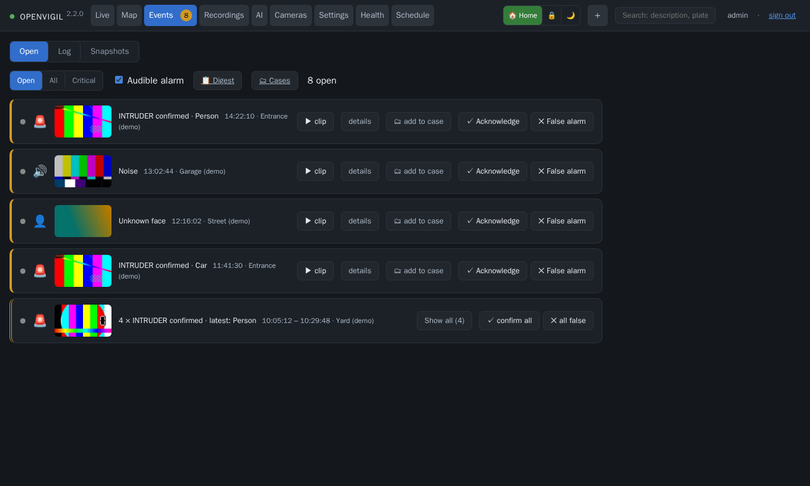

- **Groups.** When a camera raises 3 or more incidents of the same type no more than 30 minutes
  apart, they show up as a single card. From the card: **✓ confirm all**, **✕ all false** or
  **Show all (n)** (unfolds them so you can handle them one by one). The guard (operator role) can
  handle groups too, on their own cameras.
- **A picture on every incident.** Each incident has a thumbnail of the saved frame closest to
  the moment; clicking it opens the event sheet.
- **More incidents.** The list shows the newest first; **Load more incidents** brings up to 480.
- **On a phone: swipe.** On an open incident, swipe **right** to confirm it or **left** for a
  false alarm. **Cancel** stays on screen for a few seconds in case you got it wrong. The
  buttons are still there; swiping is only a shortcut.

<p align="center">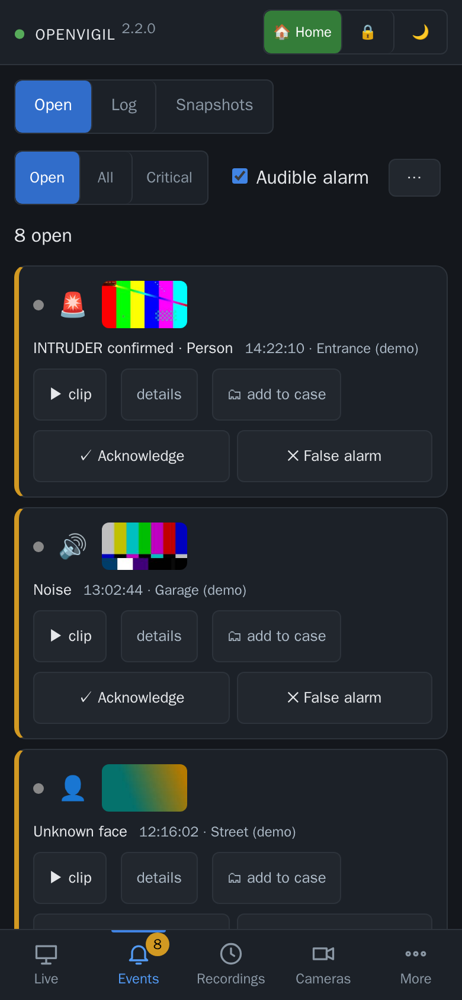</p>

## "While you were away"

**Where:** at the top of **Live**, on its own, when you come back after more than 2 hours.

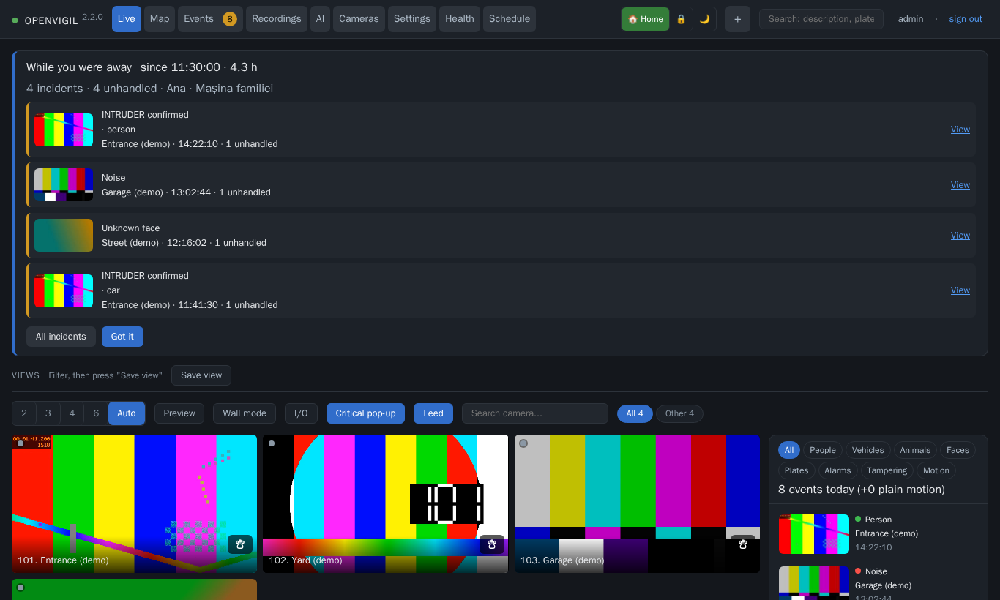

The card summarises what happened since you last looked on that device: grouped incidents with
pictures, who came (known faces and number plates) and the cameras that went down. **Got it**
closes it and moves the marker to "now". Each device keeps its own marker.

## Choosing the stream in HD

**Where:** open a camera in HD (click its tile) → the selector next to **Boxes** / **Bookmark**.

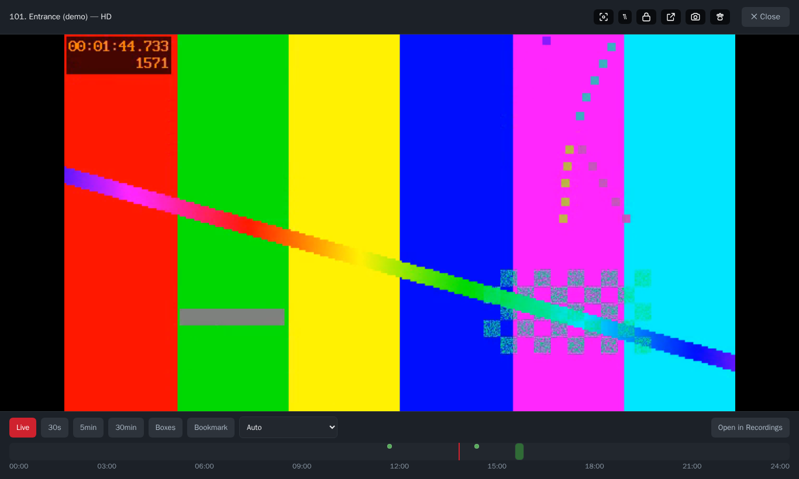

| Option | What you see | When to choose it |
|---|---|---|
| **Auto** | starts on the small stream and switches to HD when ready | default |
| **Small stream (camera)** | only the camera's second stream | slow network, mobile data |
| **HD 720p** | the main stream, scaled to 720p | phone, weak Wi-Fi |
| **HD native** | the main stream at the camera's resolution | details (plate, face) |

Only one stream plays at a time, so a phone no longer shows overlapping pictures. In
Recordings, "Small stream" means 720p.

## The property map

**Where:** the **Map** tab. Setup is done by an admin, with **Edit**.

Until now the map was a sketch with cameras and cones. In 2.2.0 it can show what each camera
sees, exactly where people are right now and where people usually walk.

### Click a camera: its picture on the plan

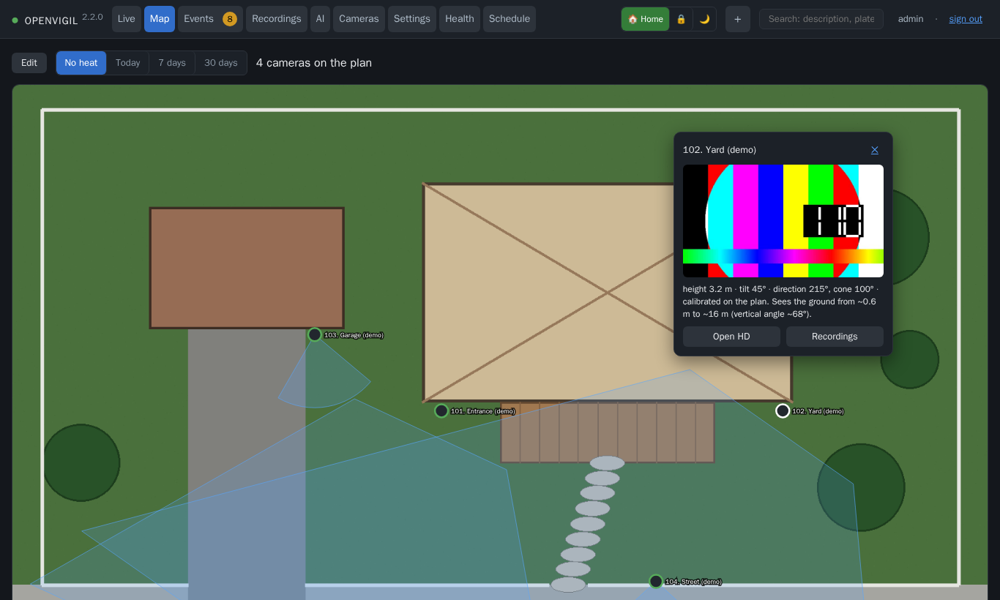

Clicking a camera opens a card with its picture (refreshed every 5 seconds) next to its cone on
the plan, so you can check that what it films matches its place. From the card: **Open HD** or
**Recordings**. Esc or a click outside closes it. On a phone the card appears below the map.

### Setup, in order (admin)

1. **The plan.** **Edit** → **New plan** → **Upload image**: a sketch of the yard, a satellite
   screenshot or an architectural plan (PNG, JPEG or WebP, up to 8 MB).
2. **The cameras.** In the right-hand panel, clicking a camera under "Unplaced cameras" puts it
   in the middle; drag it into place. With it selected: **Viewing direction** and **Cone angle**.
3. **Mounting (optional).** In the same panel, under the camera's picture: **Height (m)** and
   **Tilt (° below horizontal)**: 0 = looking straight ahead, 90 = straight down. The panel
   tells you which stretch of ground the camera sees ("from ~2.4 m to ~42 m").

   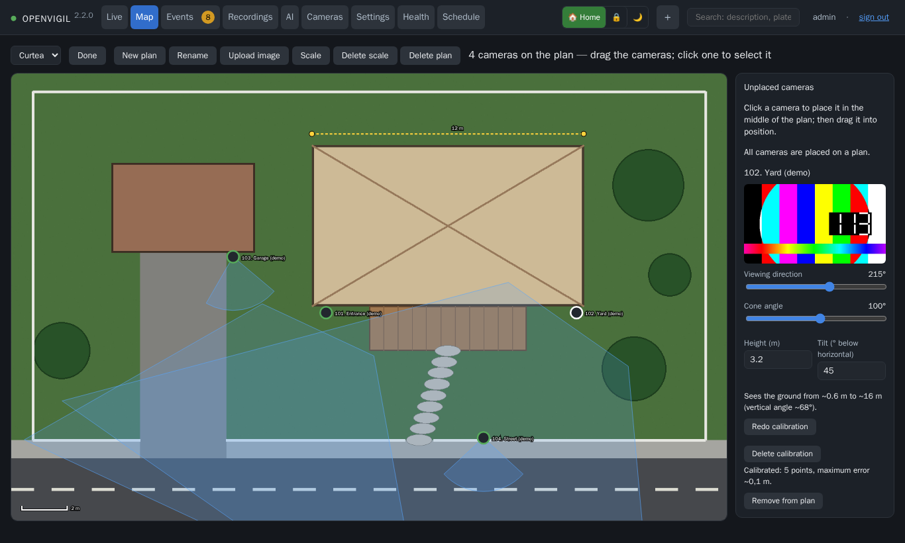

4. **Scale (optional).** **Scale** in the edit bar → click two points of a distance you know
   (the fence, a side of the house) → type how many metres it is. A scale bar appears in the
   corner, and cameras with a height and tilt draw **the ground area they actually see**, with
   the blind spot under them, instead of the symbolic cone.
5. **Calibration on the plan (optional, for live dots and the heat map).** With the camera
   selected → **Calibrate on the plan**. The camera frame and the plan open side by side:
   - click a point **on the ground** in the frame (a path corner, the base of a gate post, the
     corner of the house at ground level), then **the same spot** on the plan;
   - repeat for **4 to 12 pairs**, spread over the whole visible area, not along a line;
   - points can be dragged afterwards; **Undo last point** removes the last pair; **New frame**
     takes a fresh picture;
   - from 4 pairs, **the frame's ground grid** appears on the plan: if it lines up with reality,
     the calibration is good. Each pair's error shows up straight away (in metres if you set a
     scale); a bad pair turns red;
   - **Save**.

   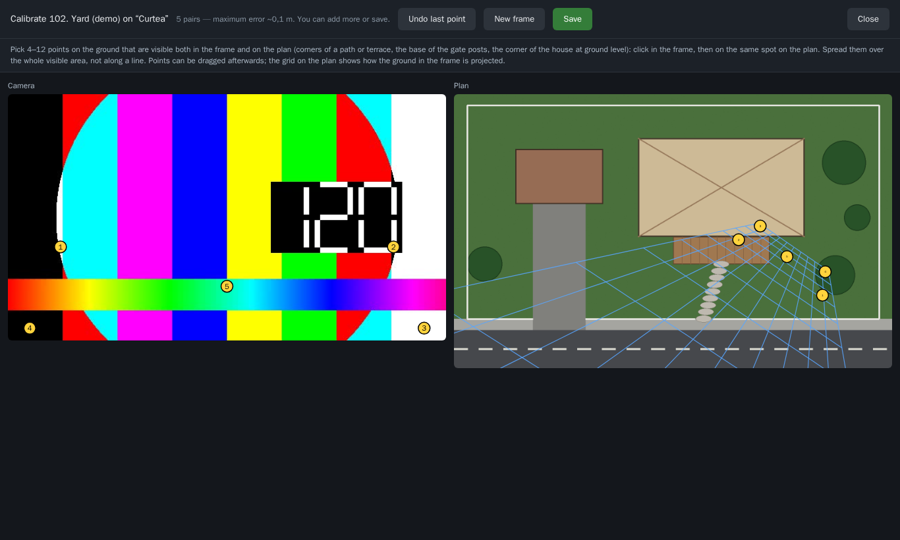

The calibration survives moving the camera's marker. A new plan image clears the scale and the
calibrations, because a different plan means different measurements.

### What you get after calibrating

- **Live detections as dots on the plan:** a person (orange) or a vehicle (blue) appears where it
  touches the ground; a faded dot is a detection older than 4 seconds.
- **A heat map of the property:** in the map bar, **No heat / Today / 7 days / 30 days**. It
  combines where people walked across all calibrated cameras: blue where people rarely pass,
  yellow on paths, red where people linger. The choice is remembered.

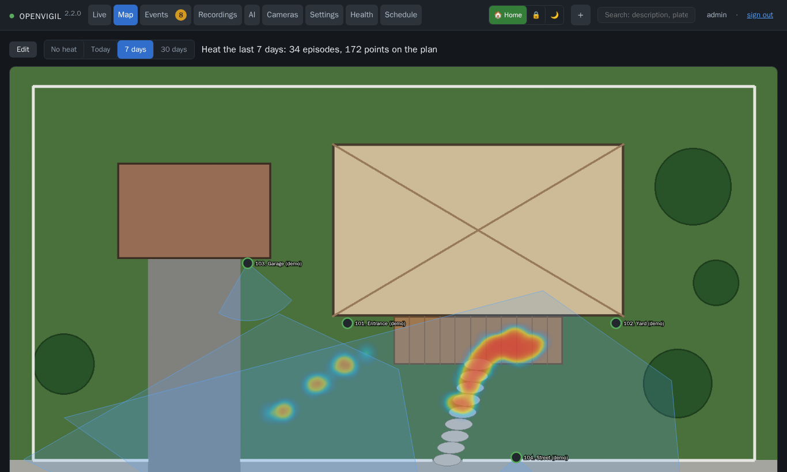

> The heat map only uses visits recorded after upgrading to 2.2.0 (older ones have no ground
> point), so it starts empty and fills up over a few days. Calibration is correct for things on
> the ground: a person on a ladder or a bird shows up in the wrong place.

## Telegram step by step

**Where:** Settings → **Notifications** → **Connect Telegram (step by step)**.

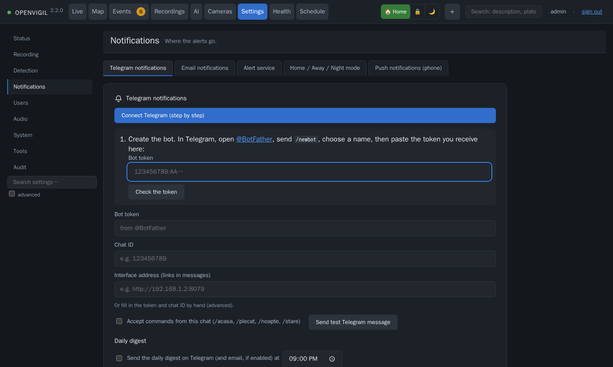

1. **Create the bot:** in Telegram, at @BotFather, send `/newbot`, pick a name and paste the
   token you receive. The token is checked on the spot.
2. **Send the bot a message** (anything). The chat is found automatically.
3. **Save.** You get a test message, so you know it works.

## System alerts through an external service, and cameras that are down

**Where:** Settings → **Notifications** → **Alert service** (optional, admin).

If you run an alert service that accepts `POST /v1/fire` (SMS, Telegram, email, with pauses and
acknowledgement), OpenVigil can send it the system alerts: camera or NVR down and back, disk
full, recording stopped or resumed, failed backup, the daily summary. Fill in **Service
address** and **API key**, then **Test the alert service**. If the service does not answer,
alerts go out on the built-in Telegram bot, as before. The full contract:
[docs/alerte.md](../alerte.md).

**With no setup at all**, two things changed for everyone:

- **A camera that is down is no longer forgotten.** The first alert comes when it goes down, then
  reminders at 4, 8, 16, 32 minutes, 1, 2, 4, 8, 16 hours, then daily, until it comes back. When
  it does, you learn how long it was gone. The schedule survives a server restart.
- **Recording problems are announced once**, when they start, and closed when they go away
  (before, a dead camera logged a "recording gap" every 2 minutes).

## Persistent semantic search and "Teach search"

**Where:** Events → **Snapshots** → the search box and the **Teach search** button; search also
works from the top bar.

- **Better questions.** "When did the bin lorry come?", "how many times did someone pass the
  gate?": the period and camera are applied before results are limited, and the answer shows the
  period covered, the evidence pictures and the first appearance.
- **Teach search.** Pick a description ("white car"), the camera and the period, then mark the
  results **Correct**, **Wrong** or **Uncertain**. Correct examples come first next time, even if
  the model scored them low; wrong ones no longer appear for that description. Details:
  [docs/semantic-feedback.md](../semantic-feedback.md).

- **Index in PostgreSQL (optional, admin).** The search index can move from per-day files to
  PostgreSQL (pgvector), with an indexing queue that does not lose days on a restart and with the
  vectors included in the backup. The move is explicit, from the command line, and reversible:
  `scripts/semantic_migrate.py` (prepare → import → verify → activate). Steps:
  [docs/semantic-search.md](../semantic-search.md).

## Interface: navigation, controls, accessibility

<p align="center">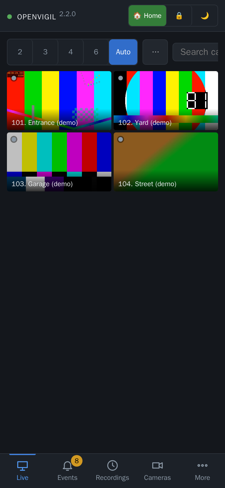 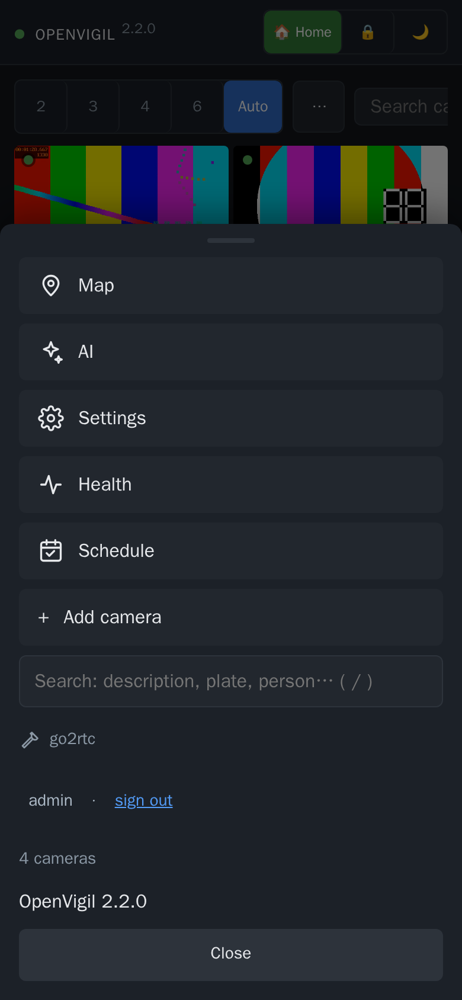</p>

- **The bottom bar on tablets and on phones in landscape too**, with **More** for the other
  screens. In landscape the tools fold away so the video fits. Nothing widens the page any more.
- **Checkboxes instead of Ctrl+click** in every multiple-choice list (they work on touch screens).
- **Less red:** plain motion is orange, red stays for real alarms. The camera's name replaces
  "cam N"; the IP address is no longer on the Live tiles.
- **New names:** the header button is **Health**, the change log in Settings is **Audit**.
- **Numbers that match:** the badge and "open" show the same number; Playback shows the recorded
  duration and the interruptions.
- **Accessibility:** WCAG AA contrast, "Skip to content", real tabs (arrows, Home/End), focus
  that never gets lost, targets of at least 24 px (32 px on touch screens), Esc closes any
  window. The window title tells you which screen you are on.

## Upgrading from 2.1.x

```bash
sudo ./install.sh --update     # git pull, the new image, restart
```

- **No changes to Compose or `.env`.** The database already uses the `pgvector/pgvector:pg16`
  image, and the `vector` extension is created automatically.
- **Semantic search stays on the per-day files** until you move it explicitly
  (see [docs/semantic-search.md](../semantic-search.md)); nothing is recomputed on its own.
- **Map:** existing plans, cameras and cones stay. Mounting, scale and calibration are optional;
  the heat map only fills up with visits after the upgrade.
- **The phone app (PWA):** close it completely once after upgrading, so it picks up the new
  interface.
