# Ce e nou în OpenVigil 2.2.0

*English: [docs/en/whats-new-2.2.0.md](../en/whats-new-2.2.0.md)*

Ghidul ăsta e pentru cine folosește interfața: ce aduce 2.2.0, **unde** găsești fiecare lucru
și **cum** îl folosești. Detaliile tehnice (formate, API, decizii) sunt în
[CHANGELOG.md](../../CHANGELOG.md) și în [manual](manual.md).

Pe scurt: triaj mai rapid, o hartă a proprietății care știe unde se întâmplă lucrurile, alegerea
fluxului în HD, o interfață accesibilă pe orice ecran, Telegram configurat în trei pași, alerte
de sistem care nu se uită și, opțional, căutare semantică persistentă în PostgreSQL.

Capturile sunt făcute în modul demo (camere sintetice), deci nu arată nicio casă reală.

- [Triaj: incidente grupate, poze, glisare](#triaj-incidente-grupate-poze-glisare)
- [„Cât ai lipsit”](#cât-ai-lipsit)
- [Alegerea fluxului în HD](#alegerea-fluxului-în-hd)
- [Harta proprietății](#harta-proprietății)
- [Telegram pas cu pas](#telegram-pas-cu-pas)
- [Alerte de sistem prin serviciul extern și camerele căzute](#alerte-de-sistem-prin-serviciul-extern-și-camerele-căzute)
- [Căutare semantică persistentă și „Învață căutarea”](#căutare-semantică-persistentă-și-învață-căutarea)
- [Interfața: navigare, controale, accesibilitate](#interfața-navigare-controale-accesibilitate)
- [Actualizarea de la 2.1.x](#actualizarea-de-la-21x)

---

## Triaj: incidente grupate, poze, glisare

**Unde:** Evenimente → **De tratat**.

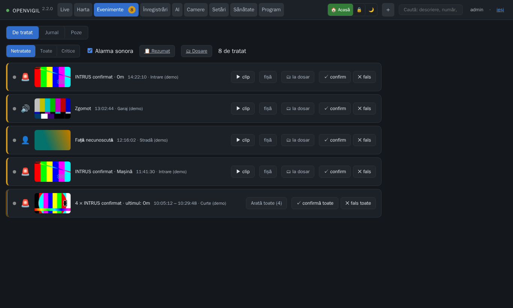

- **Grupuri.** Când o cameră dă 3 sau mai multe incidente de același tip la cel mult 30 de
  minute unul de altul, ele apar ca un singur card. Din card: **✓ confirmă toate**,
  **✕ fals toate** sau **Arată toate (n)** (le desface ca să le tratezi una câte una). Paznicul
  (rolul operator) poate trata și el grupurile, pe camerele lui.
- **Poză pe fiecare incident.** Fiecare incident are miniatura cadrului salvat cel mai apropiat
  de moment; un clic pe ea deschide fișa evenimentului.
- **Mai multe incidente.** Lista arată întâi cele mai noi; **Încarcă mai multe incidente** aduce
  până la 480.
- **Pe telefon: glisare.** Pe un incident netratat, glisează **spre dreapta** ca să-l confirmi
  sau **spre stânga** pentru alarmă falsă. Apare **Anulează** câteva secunde, dacă ai greșit.
  Butoanele rămân; glisarea e doar o scurtătură.

<p align="center">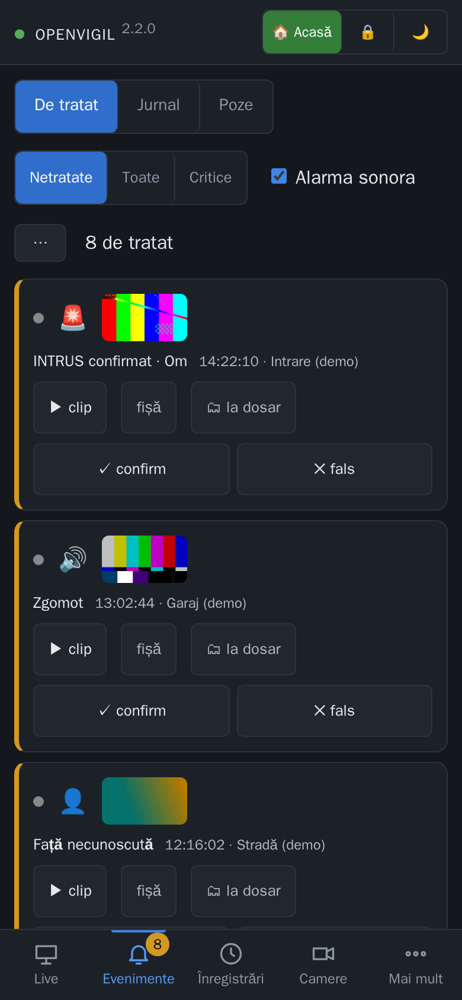</p>

## „Cât ai lipsit”

**Unde:** sus pe **Live**, singur, când revii după mai mult de 2 ore.

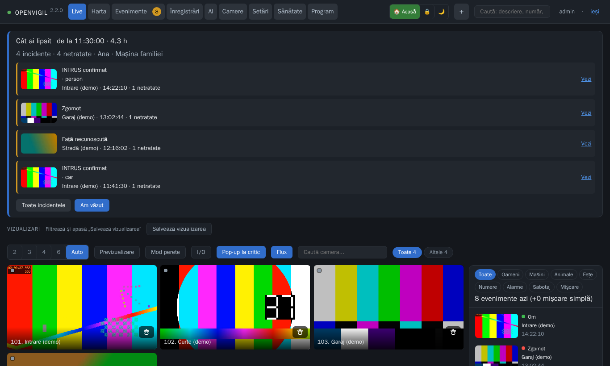

Cardul rezumă ce s-a întâmplat de la ultima privire pe acel dispozitiv: incidentele grupate,
cu poze, cine a venit (fețe și numere de mașină cunoscute) și camerele căzute.
**Am văzut** îl închide și mută reperul la „acum”. Fiecare dispozitiv își ține propriul reper.

## Alegerea fluxului în HD

**Unde:** deschide o cameră în HD (clic pe dală) → selectorul de lângă **Chenare** / **Marcaj**.

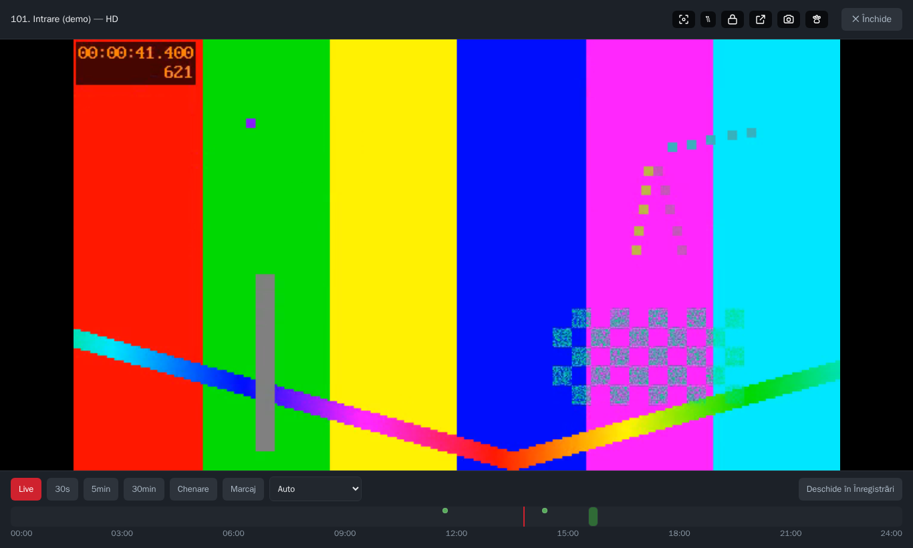

| Opțiune | Ce vezi | Când o alegi |
|---|---|---|
| **Auto** | pornește pe fluxul mic și trece pe HD când e gata | implicit |
| **Flux mic (camera)** | doar fluxul 2 al camerei | rețea lentă, date mobile |
| **HD 720p** | fluxul mare, redus la 720p | telefon, Wi-Fi slab |
| **HD nativ** | fluxul mare, la rezoluția camerei | detalii (număr, față) |

Pe ecran rulează un singur flux o dată, deci pe telefon nu mai vezi imagini suprapuse.
În Înregistrări, „Flux mic” înseamnă 720p.

## Harta proprietății

**Unde:** tabul **Harta**. Configurarea se face de admin, cu **Editează**.

Harta era până acum o schiță cu camere și conuri. În 2.2.0 poate arăta ce vede fiecare cameră,
unde exact sunt oamenii acum și pe unde se umblă de obicei.

### Clic pe o cameră: imaginea ei pe plan

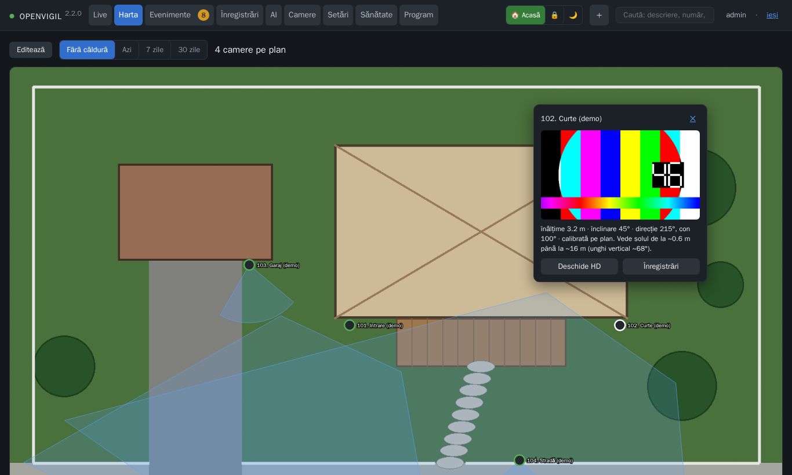

Un clic pe o cameră deschide un card cu imaginea ei (se reîmprospătează la 5 secunde), lângă
conul de pe plan, ca să vezi dacă ce filmează se potrivește cu locul. Din card: **Deschide HD**
sau **Înregistrări**. Esc sau un clic în afară îl închide. Pe telefon, cardul apare sub hartă.

### Configurarea, în ordine (admin)

1. **Planul.** **Editează** → **Plan nou** → **Încarcă imaginea**: o schiță a curții, o captură
   din satelit sau un plan de arhitectură (PNG, JPEG sau WebP, până la 8 MB).
2. **Camerele.** În panoul din dreapta, clic pe o cameră din „Camere neașezate” o pune în mijloc;
   trage-o la locul ei. Cu ea selectată: **Direcția privirii** și **Deschiderea conului**.
3. **Montajul (opțional).** Tot în panou, sub imaginea camerei: **Înălțimea (m)** și
   **Înclinarea (° sub orizontală)**: 0 = privește drept înainte, 90 = drept în jos. Panoul
   îți spune pe ce porțiune de sol vede camera („de la ~2,4 m până la ~42 m”).

   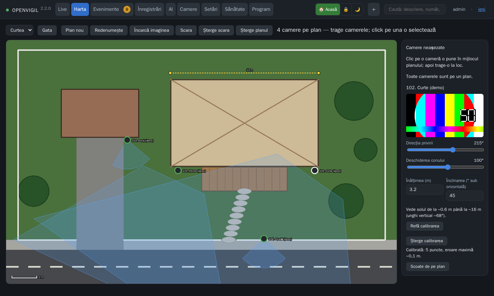

4. **Scara (opțional).** **Scara** din bara de editare → clic pe două puncte ale unei distanțe
   pe care o știi (gardul, latura casei) → scrii câți metri sunt. Apare o bară de scară în colț,
   iar camerele cu înălțime și înclinare își desenează **zona de sol pe care o văd efectiv**,
   cu pata oarbă de sub ele, în locul conului simbolic.
5. **Calibrarea pe plan (opțional, pentru punctele live și harta de căldură).** Cu camera
   selectată → **Calibrează pe plan**. Se deschid alăturat cadrul camerei și planul:
   - dai clic pe un punct **de pe sol** în cadru (colțul aleii, baza stâlpului de la poartă,
     colțul casei la pământ), apoi pe **același loc** pe plan;
   - repeți pentru **4 până la 12 perechi**, răsfirate pe toată zona văzută, nu pe o linie;
   - punctele se pot trage după aceea; **Anulează ultimul punct** scoate ultima pereche;
     **Cadru nou** ia o imagine proaspătă;
   - de la 4 perechi, pe plan apare **grila solului din cadru**: dacă se suprapune cu realitatea,
     calibrarea e bună. Eroarea fiecărei perechi se vede pe loc (în metri, dacă ai pus scara);
     o pereche greșită iese în roșu;
   - **Salvează**.

   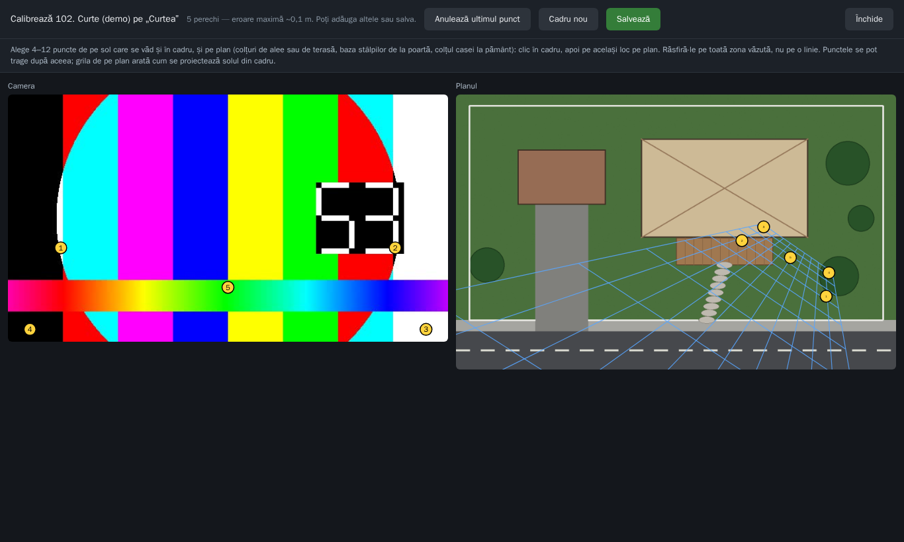

Calibrarea rămâne dacă muți marcajul camerei. O imagine nouă de plan șterge scara și calibrările,
pentru că alt plan înseamnă alte măsuri.

### Ce primești după calibrare

- **Detecțiile live ca puncte pe plan:** omul (portocaliu) sau mașina (albastru) apar în locul
  unde ating solul; un punct estompat e o detecție mai veche de 4 secunde.
- **Harta de căldură a proprietății:** în bara hărții, **Fără căldură / Azi / 7 zile / 30 zile**.
  Adună pe unde au mers oamenii pe toate camerele calibrate: albastru pe unde se trece rar,
  galben pe cărări, roșu unde se stă mult. Alegerea rămâne ținută minte.

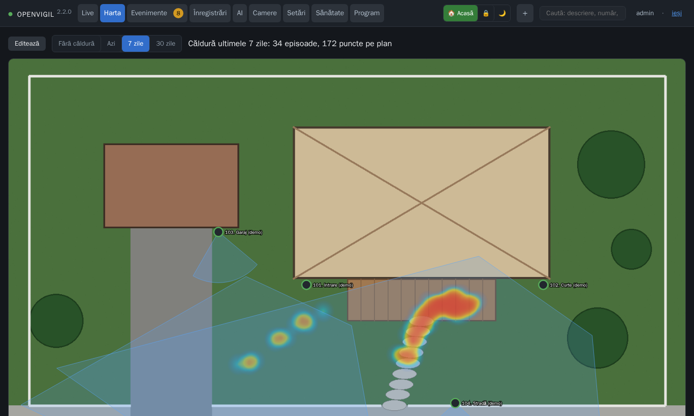

> Harta de căldură folosește doar trecerile de după actualizarea la 2.2.0 (cele vechi nu au
> punctul de sol), deci la început e goală și se umple în câteva zile. Calibrarea e corectă
> pentru lucruri de pe sol: un om pe o scară sau o pasăre apar în alt loc.

## Telegram pas cu pas

**Unde:** Setări → **Notificări** → **Conectează Telegram (pas cu pas)**.

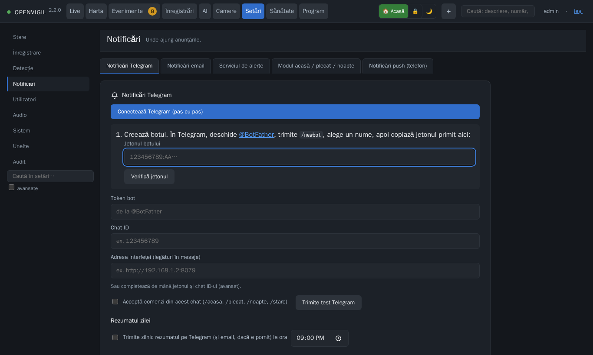

1. **Creează botul:** în Telegram, la @BotFather, trimiți `/newbot`, alegi un nume și lipești
   jetonul primit. Jetonul se verifică pe loc.
2. **Trimite-i botului un mesaj** (orice). Chat-ul se găsește singur.
3. **Salvează.** Primești un mesaj de probă, ca să știi că merge.

## Alerte de sistem prin serviciul extern și camerele căzute

**Unde:** Setări → **Notificări** → **Serviciul de alerte** (opțional, admin).

Dacă ai un serviciu de alerte care primește `POST /v1/fire` (SMS, Telegram, email, cu pauze și
confirmare), OpenVigil îi poate trimite alertele de sistem: cameră sau NVR căzut și revenit, disc
plin, înregistrare oprită sau reluată, copie de siguranță eșuată, rezumatul zilei. Completezi
**Adresa serviciului** și **Cheia API**, apoi **Testează serviciul de alerte**. Dacă serviciul nu
răspunde, alertele pleacă pe botul Telegram propriu, ca înainte. Contractul complet:
[docs/alerte.md](../alerte.md).

**Fără nicio configurare**, două lucruri s-au schimbat pentru toată lumea:

- **O cameră căzută nu mai e uitată.** Prima alertă vine la cădere, apoi mementouri la 4, 8, 16,
  32 de minute, 1, 2, 4, 8, 16 ore, apoi zilnic, până revine. La revenire afli după cât timp.
  Programul ține și peste o repornire a serverului.
- **Problemele de înregistrare se anunță o singură dată**, când apar, și se închid când dispar
  (înainte, o cameră moartă scria un „gol de înregistrare” la fiecare 2 minute).

## Căutare semantică persistentă și „Învață căutarea”

**Unde:** Evenimente → **Poze** → câmpul de căutare și butonul **Învață căutarea**; căutarea
merge și din bara de sus.

- **Întrebări mai bune.** „Când a venit mașina de gunoi?”, „de câte ori a trecut cineva pe la
  poartă?”: perioada și camera se aplică înainte de limitarea rezultatelor, iar răspunsul arată
  perioada acoperită, pozele-dovadă și prima apariție.
- **Învață căutarea.** Alegi o descriere („mașină albă”), camera și perioada, apoi marchezi
  rezultatele **Corect**, **Greșit** sau **Neclar**. Exemplele corecte apar primele data viitoare,
  chiar dacă modelul le dădea un scor mic; cele greșite nu mai apar pentru acea descriere.
  Detalii: [docs/semantic-feedback.md](../semantic-feedback.md).

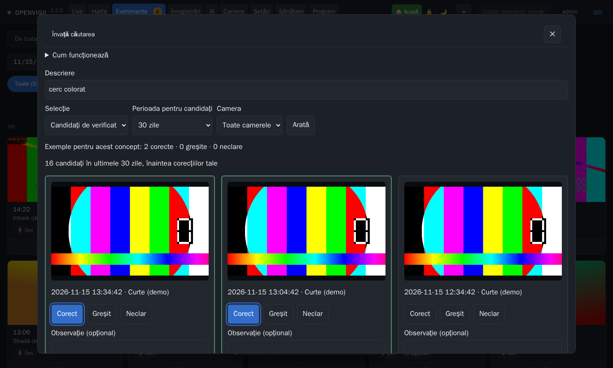

- **Index în PostgreSQL (opțional, admin).** Indexul căutării se poate muta din fișierele pe zile
  în PostgreSQL (pgvector), cu o coadă de indexare care nu pierde zile la repornire și cu copia
  vectorilor în backup. Mutarea se face explicit, din linia de comandă, și se poate întoarce:
  `scripts/semantic_migrate.py` (prepare → import → verify → activate). Pașii:
  [docs/semantic-search.md](../semantic-search.md).

## Interfața: navigare, controale, accesibilitate

<p align="center">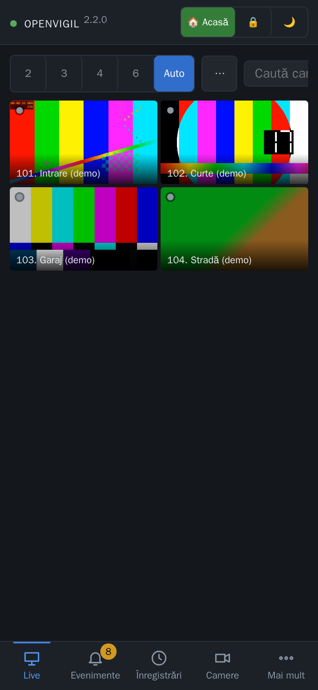 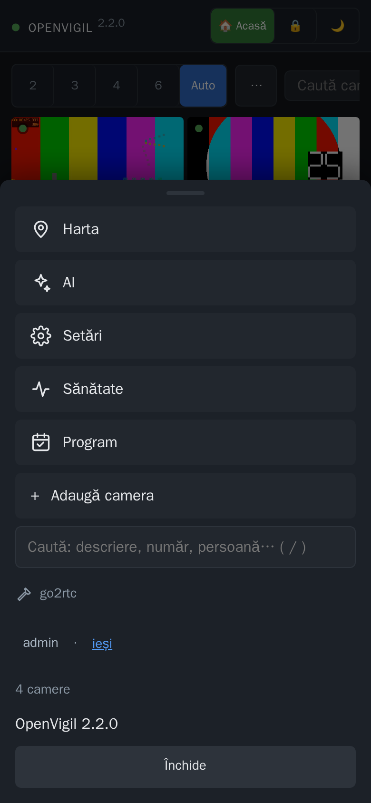</p>

- **Bara de jos și pe tabletă și pe telefonul culcat**, cu **Mai mult** pentru restul ecranelor.
  Pe telefonul culcat, uneltele se pliază ca să aibă loc videoul. Nimic nu mai lărgește pagina.
- **Bife în loc de Ctrl+clic** la orice listă cu mai multe alegeri (merg pe ecran tactil).
- **Mai puțin roșu:** mișcarea simplă e portocalie, roșul rămâne pentru alarme reale.
  Numele camerei înlocuiește „cam N”; IP-ul nu mai stă pe dalele Live.
- **Nume noi:** butonul din antet e **Sănătate**, jurnalul modificărilor din Setări e **Audit**.
- **Numere care se potrivesc:** insigna și „de tratat” arată același număr; Redarea arată
  durata înregistrată și întreruperile.
- **Accesibilitate:** contrast WCAG AA, „Sari la conținut”, taburi reale (săgeți, Home/End),
  focus care nu se pierde, ținte de minimum 24 px (32 px pe ecran tactil), Esc închide orice
  fereastră. Titlul ferestrei spune ecranul în care ești.

## Actualizarea de la 2.1.x

```bash
sudo ./install.sh --update     # git pull, imaginea nouă, repornire
```

- **Fără schimbări în Compose sau în `.env`.** Baza de date folosește deja imaginea
  `pgvector/pgvector:pg16`, iar extensia `vector` se creează singură.
- **Căutarea semantică rămâne pe fișierele pe zile** până o muți explicit
  (vezi [docs/semantic-search.md](../semantic-search.md)); nimic nu se recalculează singur.
- **Harta:** planurile, camerele și conurile existente rămân. Montajul, scara și calibrarea sunt
  opționale; harta de căldură se umple doar cu trecerile de după actualizare.
- **Aplicația de pe telefon (PWA):** închide-o complet o dată după actualizare, ca să ia
  interfața nouă.
